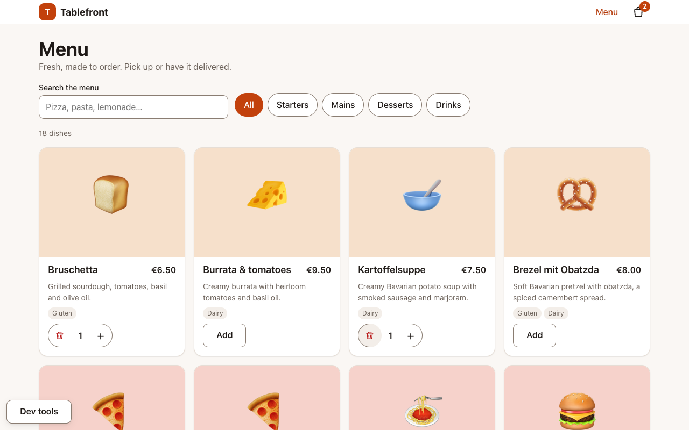
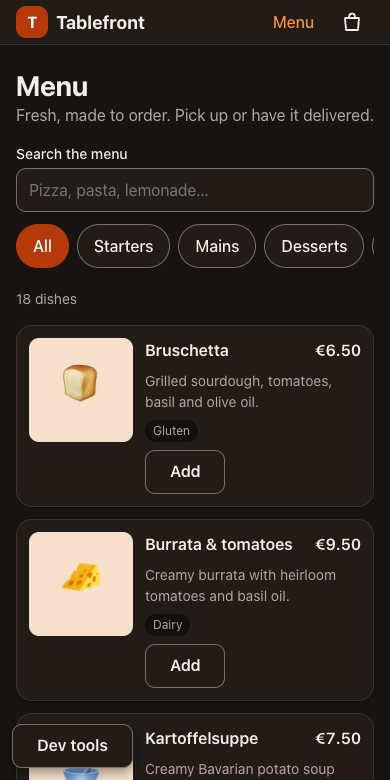
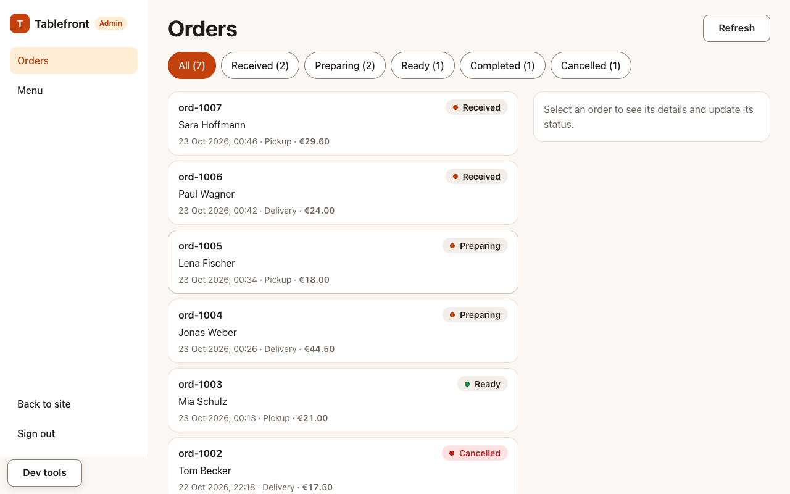
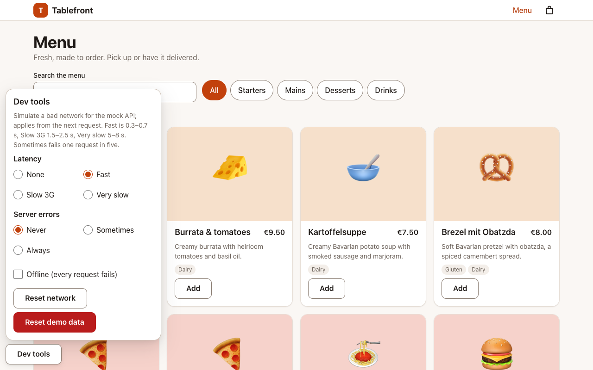

# Tablefront

A restaurant online-ordering app built with **Vue 3 + TypeScript**, as a code sample. Guests browse the menu, order for pickup or delivery and follow their order; staff run the orders board and edit the menu in an admin panel.

There is no backend: the API is simulated in the browser with [MSW](https://mswjs.io), including latency, failures and a database that survives reloads. A **Dev tools** panel lets you make the network slow, flaky or offline, so every loading, error and empty state can be seen on demand.

**Live demo:** not deployed yet (see [Not done](#not-done--would-do-next)); it runs from the repo in under a minute, see below.

|                                                          |                                                                      |
| -------------------------------------------------------- | -------------------------------------------------------------------- |
|   |  |
|  |                |

## Run it

**With pnpm** (Node 22, see `.nvmrc`; [pnpm](https://pnpm.io), the version is pinned in `package.json`):

```sh
pnpm install
pnpm dev          # http://localhost:5173
```

**With Docker** (builds the demo and serves it with nginx):

```sh
docker compose up --build   # http://localhost:8080
```

Both run the same app with the mock API on.

### Staff area

Open `/admin/login` (the "Staff login" link in the footer) and sign in with:

- email `admin@tablefront.test`
- password `admin123`

### Dev tools

The **Dev tools** button at the bottom-left opens the panel (in `pnpm dev` and the demo build only):

- **Latency**: none, fast, slow 3G, very slow.
- **Server errors**: never, sometimes (1 in 5 requests), always.
- **Offline**: every request fails and the offline banner appears.
- **Reset demo data**: back to the original menu and orders (asks for a second click).

Changes apply from the next request. Try: set errors to _Always_ and reload the menu (error state with Retry), set latency to _Very slow_ and open an order (skeletons), go _Offline_ and place an order (the form keeps what you typed).

### The demo database

Orders and menu edits are kept in `localStorage` (key `tablefront:mock-db`), so "My orders" and the tracking page survive a reload, and two tabs share one database. It is validated on load and thrown away if it is damaged or was made from different fixtures. Tests never use it. **Reset demo data** clears it.

### Build flag

`VITE_ENABLE_MOCKS=true` puts the mock API and the Dev tools panel in a production build (the Docker image and `netlify.toml` set it). Left unset, they are not in the bundle at all and `mockServiceWorker.js` is removed from `dist/`; a real deployment would point `/api` at a real backend.

## What it does

- **Guests:** menu with category chips, debounced search and filters in the URL; dish cards with a quantity stepper; a cart drawer that survives reloads and tells you when a price changed or a dish sold out; checkout with hand-written validation and server errors on the right fields; order tracking with a status stepper and polling; "My orders".
- **Staff:** sign-in with a guarded `/admin`; an orders board that refreshes itself and changes status optimistically (undone with an explanation if the server refuses); menu management with search, add, edit, delete and an unsaved-changes guard.
- **Everywhere:** loading, error, empty and success states, a polite offline banner, an error boundary, keyboard and screen-reader support, light and dark themes, mobile-first layouts. See [accessibility and performance notes](docs/accessibility.md).

## Architecture

```
 pages (smart)  ──►  composables / Pinia stores  ──►  src/api (typed fetch client)  ──►  /api
 components (presentational: props in, events out)                                       │
                                                                                          ▼
                                                              MSW handlers ──► in-memory db (+ localStorage)
```

- **Pages fetch and orchestrate; components render.** Components know nothing about the API or stores.
- **One place for HTTP.** `src/api` has a single `fetch` wrapper (timeout, abort, typed `ApiError` with field errors, bearer token, central 401 handling) and one module per resource. Nothing else calls `fetch`.
- **Hand-written async state.** `useAsyncState` (cancels on change and unmount, never shows a stale answer) and `usePolling` (one request at a time, pauses in hidden tabs, backs off on errors) sit under `AsyncBoundary`, which renders the four states from slots.
- **Pinia only where state is shared**: cart, session, remembered orders, toasts. List and page state is plain composables.
- **Money is integer cents** end to end; strings are parsed, never multiplied.

Why these choices, and what would change with a real backend: [docs/DECISIONS.md](docs/DECISIONS.md).

### Folder map

| Path              | What is there                                                                                                                |
| ----------------- | ---------------------------------------------------------------------------------------------------------------------------- |
| `src/api`         | The `fetch` client, `ApiError`, and `menuApi`, `ordersApi`, `authApi`, `adminApi`                                            |
| `src/mocks`       | MSW handlers, fixtures, the in-memory database and its persistence, failure-injection conditions                             |
| `src/domain`      | Pure logic with no Vue: money, cart math, status transitions, form validation, guards                                        |
| `src/stores`      | Pinia stores and their storage: cart, auth, my orders, toasts                                                                |
| `src/composables` | `useAsyncState`, `usePolling`, `useAdminOrders`, `useAdminMenu`, focus trap, media query, and so on                          |
| `src/components`  | Base UI (button, input, dialog, skeleton, boundary...) and feature components (`cart`, `menu`, `order`, `checkout`, `admin`) |
| `src/pages`       | One component per route; `admin/` for the staff area                                                                         |
| `src/layouts`     | Guest and admin shells                                                                                                       |
| `src/router`      | Lazy routes, typed meta, scroll behaviour, focus and title on navigation                                                     |
| `src/devtools`    | The Dev tools panel (loaded only when the mock API is)                                                                       |
| `src/styles`      | Reset, design tokens (light and dark), base styles                                                                           |
| `src/test`        | Test setup (MSW server) and helpers                                                                                          |
| `docs`            | Accessibility notes, decisions, and one description per pull request (`docs/pr`)                                             |

## Scripts

| Script              | What it does                                       |
| ------------------- | -------------------------------------------------- |
| `pnpm dev`          | Vite dev server with HMR                           |
| `pnpm build`        | Production build into `dist/`                      |
| `pnpm preview`      | Serve the production build locally                 |
| `pnpm lint`         | ESLint (flat config, type-aware)                   |
| `pnpm lint:fix`     | ESLint with autofix                                |
| `pnpm format`       | Prettier, write                                    |
| `pnpm format:check` | Prettier, check only (used in CI)                  |
| `pnpm typecheck`    | `vue-tsc --build` over the app and tooling configs |
| `pnpm test`         | Vitest, single run                                 |
| `pnpm test:watch`   | Vitest in watch mode                               |

CI runs formatting, lint, types, tests and the build on every pull request, and builds the Docker image and checks that it serves the app.

### Tests

Several hundred tests (`pnpm test`; Vitest, jsdom, Vue Test Utils). Most are integration tests that mount the real app against the MSW server, so a test goes through router, stores, composables and the mock API like a user does. Timing-dependent code (polling, debounce) is tested with fake timers.

## Not done / would do next

- **A live demo URL.** The deploy config is there (`netlify.toml`, and the Docker image runs anywhere); it has not been deployed yet.
- **End-to-end tests in a real browser** (planned as the last pull request: Playwright against the demo build).
- **A real backend and real authentication.** The token is a fixed string and `/api` is simulated. See DECISIONS.md for what would change.
- **Payments, i18n, push notifications** are out of scope by design.
- **A screen-reader pass** (VoiceOver, NVDA). Accessibility was checked structurally and by keyboard; see the notes.
- **Server-driven order updates** (WebSocket or SSE) instead of polling.
- **Pagination and sorting** for the admin tables; twenty dishes and a couple of hundred orders do not need them.
- **Image upload** for dishes; an image address is typed in.
